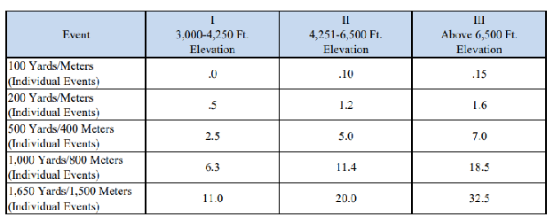

Large scale project pivot, standalone tool is too large and too heavy to run alone

Scope to reengineer the concept and tools developed within the omni swim project as an extension to chrome that will run and ‘upgrade’ swimcloud meet simulator, along with creating a locally accessible dashboard that can work in conjunction with the current ‘regular access’ swimcloud.

Reasoning \- rather than trying to build a backend to store and pull from swimcloud, use the existing swimcloud framework and add addtl. Features

Source to study/interact/learn from: 

Items that need to be built (incl. All the wiring and headroom to run in conjunction with this)

Main tool (attached to current/regular swimcloud meet simulator)

1. Data Sourcing  
   1. Larger Date brackets for data sourcing (max we can look back is 3 years from current date, lets expand?)  
      1. Expansion for date brackets should automatically remove athletes not on selected season (add subselection for season roster and event record range)   
      2. Allowance/visibility for selecting swims with time conversions (swimcloud already can do this, if needed the time factors are provided see table a,b,d)  
      3. Actually pulling fastest relay splits from selected record range (some times are not accurate, will pull splits from closer to current dates rather than all time)  
         1. Time Conversion \+ flyover boost (if a time from an event is faster converted from another course vs scy, show it and also subtract time for a flyover)  
      4. Cutline Tracking and Tagging (ncaa d2 standards already present on swimcloud, tag whos close/achieved cuts, if someone is close, show how far off they are)   
2. Adjustment to scoring rules  
   1. Total roster scoring headcount limitation (total number of team members allowed on scoring team)  
   2. adding diver weighting manipulation like nsisc where divers are ⅓ of rull roster limit  
   3. Tagging swimmers as scorers/nonscorers, will also automatically run the logic for point calculation  
   4. Adjustment to athlete-specific limitations for swims (current entry limits tab shows ‘individual per-athlete limit’ with max of 5, and you can use ‘-’ in the ‘per-team’ to unlock ‘unlimited’ entries in each event. Relay per athlete/per team limit dropdowns do not need changing, but in certain cases rules may cap the maximum total entries per athlete (nsisc caps at 8 total, you can cut it any way you would like, usually 4I/4R, 3I/5R, you could also choose to not swim the maximum number of events allowed)  
   5. Adjusting maximum scoring swimmers per event from numerical button toggle to dropdown and adding ‘-’ or ‘unlimited’ option.  
3. Related to 2.4, Meet Planner  
   1. (not all meets are structured the same way, so load management is important) Adding tags to organize when events occur so you can show athletes the outlook for what events occur on what day  
      1. Saved Presets for event order+time of occurrence (for now we can go day \#, second column can be time of day dropdown for morning/afternoon/evening)  
4. Elevated Scoring/Roster Build Logic  
   1. Solution \- AutoBuilder (intelligently adjusts to the competition, like a goal seek in excel, provides a cushion and adjusts who is on the scoring team vs not, adjusts event lineup per swimmer too, recalculates)  
      1. Most ‘common’ logic is to just put your fastest swimmers in their fastest events, which is an occurrence most of the time.   
      2. Sometimes, someone needs to swim an event they don’t normally swim to score points, because it is a thin field or they hold a unique edge over competition  
      3. Logic needs to work with event/entry limitations  
      4. Logic needs to also account for the meet planner (usually people only swim 1-2 races per session, for load mgmt)  
      5. Certain teams might struggle with the problem of being ‘too deep’ i.e. Too many fast swimmers, cannot afford to add absolutely everybody into the scoring team who is fast in events.  
5. Addtl. Items/Tweaks/Improvements  
   1. Dark mode and color theming  
   2. Score visualization charting through events  
   3. Using historical tendencies of similar swimmers, charting previous events or other factors to guess other teams lineups and entries  
   4. Stylization and ui should flow and be collectively unified, should look like swimcloud, not like the omni swim suite.

Table A: SCM to SCY Conversions

| Event Factor  | Factor |
| :---- | :---- |
| 400 meters to 500 yards | 1.143 |
| 800 meters to 1000 yards | 1.143 |
| 1500 meters to 1650 yards | 1.003 |
| All other events | .896 |

Table B: Altitude Adjustments  
  
Subtract the time above from the actual time achieved. A relay team may use a conversion that is four times the appropriate figures listed above. This is the time to be used on the entry form 

Table C: NSISC Event Order

| NSISC Event Order |  |  |
| :---- | :---- | :---- |
| Day | Time | Event |
| 1 | Evening | 800 Freestyle Relay (Finals) |
|   |   |   |
| 2 | Morning | 200 Individual Medley, 50 Freestyle, 1000   Freestyle (Prelims) |
| 2 | Afternoon | One Meter Dive (Men) (Prelims) |
| 2 | Evening | 200 Individual Medley, 50 Freestyle, 1000   Freestyle, 200 Medley Relay, One Meter Dive (Men) (Finals) |
|   |   |   |
| 3 | Morning | 100 Butterfly, 400 Individual Medley, 200   Freestyle (Prelims) |
| 3 | Afternoon | Three Meter Dive (Women) (Prelims) |
| 3 | Evening | 100 Butterfly, 400 Individual Medley, 200   Freestyle, 400 Medley Relay, Three Meter Dive (Women) (Finals) |
|   |   |   |
| 4 | Morning | 500 Freestyle, 100 Backstroke, 100 Breaststroke,   200 Butterfly (Prelims) |
| 4 | Afternoon | Three Meter Dive (Men) (Prelims) |
| 4 | Evening | 500 Freestyle, 100 Backstroke, 100 Breaststroke,   200 Butterfly, 200 Freestyle Relay, Three Meter Dive (Men) (Finals) |
|   |   |   |
| 5 | Morning | 100 Freestyle, 200 Backstroke, 200 Breaststroke,   1650 Freestyle (Prelims) |
| 5 | Afternoon | One Meter Dive (Women) (Prelims) |
| 5 | Evening | 100 Freestyle, 200 Backstroke, 200 Breaststroke,   1650 Freestyle, 400 Freestyle Relay, One Meter Dive (Women) (Finals) |

Table D: LCM to SCY Conversion Table

| Event | LCM to SCY Base Multiplier | Turn Adjustment (Seconds Subtracted) | Formula (LCM to SCY) |
| :---- | :---- | :---- | :---- |
| 50 Freestyle | 0.892 | 0.80s | $(LCMTime-0.80)\times 0.892$ |
| 100 Freestyle | 0.892 | 1.60s | $(LCMTime-1.60)\times 0.892$ |
| 200 Freestyle | 0.892 | 3.20s | $(LCMTime-3.20)\times 0.892$ |
| 400 / 500 Freestyle | 0.892 | 6.40s | $(LCM400mTime-6.40)\times 0.892\rightarrow SCY500yd$ |
| 800 / 1000 Freestyle | 0.892 | 12.80s | $(LCM800mTime-12.80)\times 0.892\rightarrow SCY1000yd$ |
| 1500 / 1650 Freestyle | 0.892 | 24.00s | $(LCM1500mTime-24.00)\times 0.892\rightarrow SCY1650yd$ |
| 50 Backstroke | 0.892 | 0.60s | $(LCMTime-0.60)\times 0.892$ |
| 100 Backstroke | 0.892 | 1.20s | $(LCMTime-1.20)\times 0.892$ |
| 200 Backstroke | 0.892 | 2.40s | $(LCMTime-2.40)\times 0.892$ |
| 50 Breaststroke | 0.892 | 1.00s | $(LCMTime-1.00)\times 0.892$ |
| 100 Breaststroke | 0.892 | 2.00s | $(LCMTime-2.00)\times 0.892$ |
| 200 Breaststroke | 0.892 | 4.00s | $(LCMTime-4.00)\times 0.892$ |
| 50 Butterfly | 0.892 | 0.70s | $(LCMTime-0.70)\times 0.892$ |
| 100 Butterfly | 0.892 | 1.40s | $(LCMTime-1.40)\times 0.892$ |
| 200 Butterfly | 0.892 | 2.80s | $(LCMTime-2.80)\times 0.892$ |
| 200 IM | 0.892 | 3.00s | $(LCMTime-3.00)\times 0.892$ |
| 400 IM | 0.892 | 6.00s | $(LCMTime-6.00)\times 0.892$ |
| 200 Free Relay | 0.892 | 3.20s | $(LCMTime-3.20)\times 0.892$ |
| 400 Free Relay | 0.892 | 6.40s | $(LCMTime-6.40)\times 0.892$ |
| 800 Free Relay | 0.892 | 12.80s | $(LCMTime-12.80)\times 0.892$ |
| 200 Medley Relay | 0.892 | 3.20s | $(LCMTime-3.20)\times 0.892$ |
| 400 Medley Relay | 0.892 | 6.40s | $(LCMTime-6.40)\times 0.892$ |

